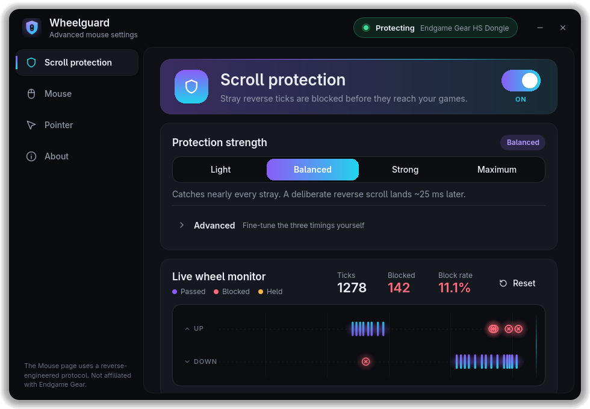

<h1 align="center">
  <br>
  Wheelguard
</h1>

<p align="center">Stop stray scroll ticks and tune your Endgame Gear mouse, on GNOME.</p>

<p align="center"></p>

## Install

```sh
sudo dnf config-manager addrepo --from-repofile=https://djshiye.github.io/wheelguard/wheelguard.repo
sudo dnf install wheelguard
```

Then open **Wheelguard** from the app grid. **Update:** `sudo dnf upgrade`.
**Uninstall:** `sudo dnf remove wheelguard`. Packages are unsigned.

## Features

- **Scroll bounce filter** that drops wrong-direction wheel ticks, with a live monitor of every tick
- **Hardware mouse settings** for the Endgame Gear XM2w 4k v2: DPI, polling rate, lift-off distance,
  debounce, sleep and battery
- **GNOME pointer settings** (speed, acceleration, scrolling) in the same app
- **Panel icon** with an instant popup (battery, scroll protection, DPI stage); closing the window keeps
  it running there, and it starts at login (switch on the About page). The icon is a GNOME Shell
  extension, enabled automatically after the next login. Without it a tray icon is used if available,
  otherwise closing the window quits.
- **Runs as a background service**: a user daemon starts with your session, the app is optional
- **Light and dark**, following GNOME

<details>
<summary>How the filter works</summary>

The daemon grabs the mouse and tracks a direction lock: the way you have been scrolling. Ticks in
that direction pass at once, with no added latency. A reversal right after a tick is dropped, and
any other reversal is held for a few milliseconds: if the lock direction returns, it was a bounce;
if a second reversal follows or nothing happens, it was real. Everything else is forwarded
untouched. Tuning keys are in `~/.config/wheelguard/config.json`, the app talks to the daemon over
a Unix socket ([PROTOCOL.md](PROTOCOL.md)).

</details>

<details>
<summary>Building / publishing</summary>

Everything is built locally, there is no CI. `tools/publish.sh` builds the RPM in a Fedora
container with podman, updates the DNF repository on the `gh-pages` worktree (`.gh-pages/`) and
commits it. Add `--push` to push `main` and `gh-pages`; `--allow-dirty` builds the working tree
for testing. Run the tests with `python3 -m unittest discover -s tests -t .`. The mouse's HID
protocol is documented in [docs/endgame-protocol.md](docs/endgame-protocol.md).

</details>

---

MIT licensed. Wheelguard is an independent project and is not affiliated with or endorsed by
Endgame Gear.
