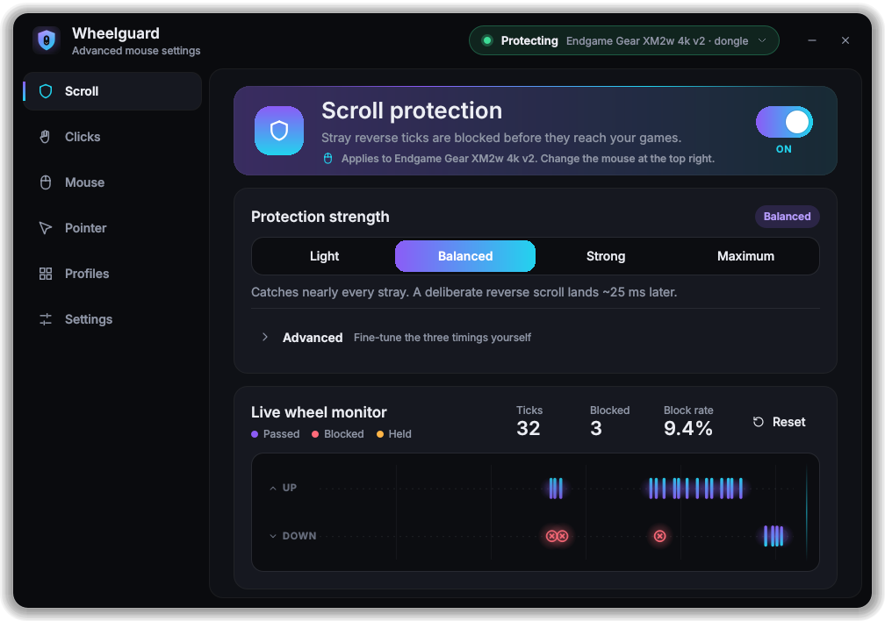

<h1 align="center">
  <br>
  Wheelguard
</h1>

<p align="center">Stop stray scroll ticks and tune your gaming mouse, on GNOME.</p>

<p align="center"></p>

## Install

```sh
sudo dnf config-manager addrepo --from-repofile=https://djshiye.github.io/wheelguard/wheelguard.repo
sudo dnf install wheelguard
```

Then open **Wheelguard** from the app grid. **Update:** `sudo dnf upgrade`.
**Uninstall:** `sudo dnf remove wheelguard`. One package works on every current Fedora release.
Packages and repository metadata are signed; dnf asks once to trust the key
([RPM-GPG-KEY-djshiye](https://djshiye.github.io/wheelguard/RPM-GPG-KEY-djshiye)). The package
installs its own `/etc/yum.repos.d/wheelguard.repo`, so the repository stays configured.

## Features

- **Scroll bounce filter** that drops wrong-direction wheel ticks, with a live monitor of every tick
- **Hardware mouse settings**, stored on the mouse:
  - Endgame Gear XM2w 4k v2: DPI stages, polling rate, lift-off distance, debounce, button actions,
    sleep and battery
  - Logitech G Pro X Superlight (first generation): DPI stages (edits the mouse's onboard profile),
    polling rate up to 1000 Hz, battery
  - Razer DeathAdder V4 Pro: DPI stages with separate X/Y, polling rate up to 8000 Hz, sleep timer,
    low-battery warning, battery
- **Scroll filter for every supported mouse**: the daemon picks up whichever one is connected
- **GNOME pointer settings** (speed, acceleration, scrolling) in the same app
- **Panel icon** with an instant popup (battery, scroll protection, DPI stage); closing the window keeps
  it running there, and it starts at login (switch on the About page). The icon is a GNOME Shell
  extension, enabled automatically after the next login. Without it a tray icon is used if available,
  otherwise closing the window quits.
- **Runs as a background service**: a user daemon starts with your session, the app is optional
- **Light and dark**, following GNOME

<details>
<summary>How the filter works</summary>

The daemon grabs the mouse and tracks a direction lock: the way you have been scrolling. Ticks in
that direction pass at once, with no added latency. A reversal right after a tick is dropped, and
any other reversal is held for a few milliseconds: if the lock direction returns, it was a bounce;
if a second reversal follows or nothing happens, it was real. Everything else is forwarded
untouched. Tuning keys are in `~/.config/wheelguard/config.json`, the app talks to the daemon over
a Unix socket ([PROTOCOL.md](PROTOCOL.md)).

</details>

<details>
<summary>Building / publishing</summary>

GitHub Actions (`.github/workflows/ci.yml`) builds and tests the RPM on every push and pull
request. Pushes to `main` also sign it (key in the `RPM_SIGNING_KEY` secret), rebuild the DNF
repository with the last three builds (`build-aux/dnf-repo.py`), commit it to the `gh-pages`
branch that GitHub Pages serves, and install it in clean Fedora 44 and 45 containers
(`build-aux/verify-install.sh`). The old local `tools/publish.sh` is retired: one publishing path
is less to maintain, and local builds could not be signed. Run the tests with `python3 -m unittest discover -s tests -t .`. The mice's
protocols are documented in [docs/endgame-protocol.md](docs/endgame-protocol.md),
[docs/logitech-protocol.md](docs/logitech-protocol.md) and [docs/razer-protocol.md](docs/razer-protocol.md).

</details>

---

MIT licensed. Wheelguard is an independent project and is not affiliated with or endorsed by
Endgame Gear, Logitech or Razer.
